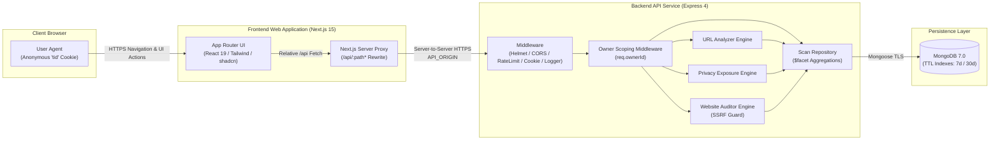
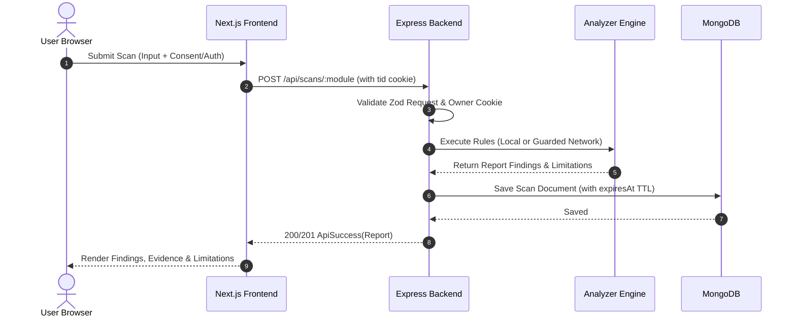
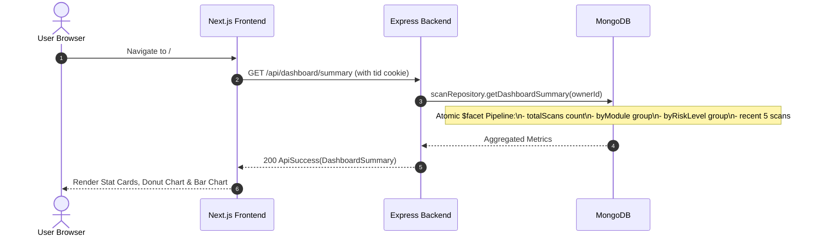

# Threatory System Architecture

This document describes the end-to-end technical architecture of Threatory, including request topologies, frontend and backend structures, domain analysis modules, data persistence, and security controls.

---

## 1. High-Level Architecture

Threatory is organized as an npm workspaces monorepo with strict boundary separation between shared contracts, the backend API service, and the Next.js frontend application.

### Key Architectural Invariants
1. **First-Party Cookie Isolation:** The browser only talks to the frontend origin. Calls to `/api/...` are rewritten on the Next.js server to `API_ORIGIN`. As a result, the signed session cookie `tid` remains first-party with `SameSite=Lax` and `HttpOnly`.
2. **Anonymous Browser Ownership:** No user accounts, registration, passwords, or emails exist. Every scan is stamped with an anonymous UUID stored in the signed cookie. All reads, lists, and deletions enforce `{ scanId, ownerId }` scoping.
3. **Data Minimization:** No raw privacy inputs (`submittedText`), unmasked contact details, or website HTTP bodies/cookie values are ever stored in MongoDB or written to logs.

---

## 2. Frontend Architecture

The frontend is built with Next.js 15 using the App Router:

- **Routing Structure (`src/app/`):**
  - `/`: Dashboard platform overview featuring stat cards, risk distribution donut chart, scans per module bar chart, and recent scans table.
  - `/url-analyzer`: URL input form, rule-based progress state, and result presentation.
  - `/privacy-analyzer`: Dynamic profile form (1–10 items), live character counter, mandatory consent checkbox, and masked result cards.
  - `/website-auditor`: Authorized target form with mandatory authorization confirmation, SSRF safety disclosure, and 4-category audit view.
  - `/history`: Paginated scan history with URL-synchronized filters (`?module=...&status=...&page=...`). Target summaries are rendered strictly as non-clickable plain text.
  - `/reports/[scanId]`: Saved report details view with report actions (copy Markdown, copy JSON, print, delete).
  - `/help`: Plain-language guide to methodology, storage rules, and retention.
  - `not-found.tsx`, `error.tsx`, `global-error.tsx`: User-friendly, branded error and 404 boundaries with zero stack traces or secret leaks.
  - `icon.svg`: High-resolution SVG favicon automatically served by Next.js.
- **Component Design System:**
  - Tailwind CSS design tokens and shadcn/ui primitives (`Button`, `Card`, `Badge`, `Alert`, `Skeleton`).
  - Strict plain-text rendering for all user-supplied inputs and URLs (no `dangerouslySetInnerHTML`, no clickable external navigation anchors).
  - `@media print` rules hiding navigation and action bars (`data-no-print`), ensuring print and PDF exports preserve evidence and limitations.
- **State Management & Caching:**
  - TanStack Query v5 manages asynchronous report fetching, query caching, background polling, and cache invalidation on report deletion.
  - Form validation powered by React Hook Form integrated with Zod schemas from `@threatory/contracts`.

---

## 3. Backend Architecture

The backend is an Express 4 service compiled from strict TypeScript:

- **Middleware Pipeline (in exact execution sequence):**
  1. `TRUST_PROXY`: Configurable trust proxy for reverse proxy / load balancer deployment.
  2. `httpLogger`: Pino HTTP logger configured with redaction covering cookies, authorization headers, request bodies, response bodies, and sensitive keys.
  3. `helmet()`: Comprehensive HTTP security headers (X-Content-Type-Options, Frameguard, etc.).
  4. `cors()`: Dynamic origin validation matching `FRONTEND_ORIGIN` with credentials support; restricts methods to `GET, POST, DELETE, OPTIONS`.
  5. `generalLimiter`: Rate limit of 100 requests / 15 min returning standardized `RATE_LIMITED` envelopes.
  6. `scanLimiter`: Stricter rate limit of 20 requests / 15 min mounted on `/api/scans`.
  7. `express.json({ limit: "20kb" })`: Hard body size limit preventing memory exhaustion; malformed payloads return 400 `VALIDATION_ERROR`.
  8. `cookieParser(COOKIE_SECRET)`: Cryptographic cookie verification.
  9. `ownerMiddleware`: Assigns or validates the signed `tid` cookie holding the random owner UUID.
- **Central Error Handling:**
  - Catches `AppError`, `ZodError`, body parser rejections (413 and 400), and unhandled exceptions.
  - Maps to standard error format: `{ success: false, error: { code, message, fields? } }`.
  - Zero internal stack traces or database errors exposed in responses.

---

## 4. Analyzer Architecture

### A. URL Analyzer (`backend/src/modules/url/`)
- **Normalization:** Uses `tldts` and `node:url` to normalize hostnames, handle hexadecimal/octal/integer IP representations, and strip user credentials (`user:pass@`).
- **Core Rules (11 rules):** Evaluates `URL_NO_HTTPS`, `URL_IP_HOST`, `URL_USERINFO`, `URL_ENCODED`, `URL_REDIRECT_PARAM`, `URL_HIGH_ENTROPY`, `URL_ABUSED_TLD`, `URL_EXCESS_SUBDOMAINS`, `URL_NONSTANDARD_PORT`, `URL_KEYWORDS`, `URL_LONG`.
- **Advanced Rules (5 rules):** Evaluates `URL_LOOKALIKE` (Levenshtein distance against Tranco Top 10k domains), `URL_HOMOGRAPH` (punycode `xn--` and mixed Unicode scripts), `URL_BRAND_SUBDOMAIN`, `URL_SHORTENER`, and `URL_FEED_MATCH`.
- **Scoring & Risk:** Sum of triggered rule weights capped at 100. Risk level derived from score bands (0–14 `none_detected`, 15–39 `low`, 40–69 `medium`, 70–100 `high`). A feed match forces high severity.
- **Safety Guarantee:** Zero network requests are made about the submitted link.

### B. Privacy Exposure Analyzer (`backend/src/modules/privacy/`)
- **Explicit Consent:** Enforces mandatory consent (`consent: true`); rejects missing consent with 400 `VALIDATION_ERROR`.
- **Detection Rules (9 rules):**
  - Identity: `PRIV_USERNAME_REUSE`, `PRIV_USERNAME_SIMILAR`, `PRIV_URL_USERNAME_MISMATCH`, `PRIV_USERNAME_PERSONAL_HINT`.
  - Contact: `PRIV_EMAIL_FOUND` (`validator.isEmail`), `PRIV_PHONE_FOUND` (`libphonenumber-js`), `PRIV_USERNAME_MATCHES_EMAIL`.
  - Credentials & Financial: `PRIV_SECRET_FOUND` (AWS, GitHub, Slack, Google API keys, private keys, JWTs), `PRIV_CARD_FOUND` (Luhn algorithm validation).
- **Masking Engine:** Emails masked to `j***@example.com`, phones to `+1 *** *** **53`, cards to `**** **** **** 1111`, tokens to type and first 4 characters.
- **Zero Raw Storage Guarantee:** `submittedText` is not stored, logged, or returned.

### C. Website Security Auditor (`backend/src/modules/website/`)
- **Authorization Guard:** Requires `authorised: true`.
- **SSRF Guard (`ssrf-guard.ts`):** Validates IP addresses against RFC 1918, loopbacks, link-local metadata (169.254.169.254), CGNAT, and IPv4-mapped IPv6 using `ipaddr.js`. Rejects blocked targets with 422 `TARGET_BLOCKED`.
- **DNS Rebinding Prevention:** Resolves hostname once, validates the IP, and pins the connection using Undici's custom connector (`net.connect({ host: resolvedIp, port })`).
- **Inspection Checks (20 rules):**
  - Connection & TLS: `SITE_DNS_RESOLVES`, `SITE_HTTPS_AVAILABLE`, `SITE_TLS_CERT_VALID`, `SITE_TLS_EXPIRY`, `SITE_TLS_PROTOCOL`, `SITE_HTTP_TO_HTTPS`, `SITE_REDIRECTS` (max 3 hops).
  - HTTP Headers: `SITE_HSTS`, `SITE_CSP`, `SITE_XCTO`, `SITE_FRAMING`, `SITE_REFERRER_POLICY`, `SITE_PERMISSIONS_POLICY`, `SITE_VERSION_DISCLOSURE`.
  - Cookies: `SITE_COOKIE_SECURE`, `SITE_COOKIE_HTTPONLY`, `SITE_COOKIE_SAMESITE` (cookie values never stored).
  - DNS & Email: `SITE_SPF`, `SITE_DMARC`, `SITE_CAA`.
- **Orchestration & Timeout:** Orchestrated via `Promise.allSettled` bounded by an 8s per-check timeout and 25s overall budget. Incomplete checks are marked `not_assessed`, producing a `partial` report.

---

## 5. Data Architecture

Persisted using Mongoose with MongoDB:

### Collections
1. **`scans` Collection:**
   - `scanId` (string, unique UUID index)
   - `ownerId` (string, index)
   - `module` ("url" | "privacy" | "website")
   - `status` ("completed" | "partial" | "failed")
   - `rulesVersion` (string)
   - `targetSummary` (string, safe plain text)
   - `assessment` ({ label, riskLevel, score?, scoreMeaning? })
   - `findings` (array of finding sub-documents)
   - `limitations` (array of strings)
   - `details` (optional module metadata)
   - `createdAt` (date)
   - `expiresAt` (date, TTL index with `expireAfterSeconds: 0`)
2. **`feedentries` Collection:**
   - Locally synchronized phishing and malware feed entries for offline URL matching.

### Automated Retention
- Privacy reports: `expiresAt = createdAt + 7 days`
- URL reports: `expiresAt = createdAt + 30 days`
- Website audit reports: `expiresAt = createdAt + 30 days`

---

## 6. Request Flows

### Scan Submission and Persistence Flow

### Dashboard Aggregation Flow ($facet Pipeline)

---

## 7. Deployment Topology

- **Frontend Host:** Deployed to Vercel / Netlify / Cloudflare Pages.
- **Backend Host:** Deployed via multi-stage Docker container on Render or any container runtime. Runs under unprivileged user `node`.
- **Database:** MongoDB Atlas M0 Free Cluster with TLS encryption in transit and encrypted storage at rest.
- **Network Boundaries:** Frontend communicates with Backend over HTTPS. Backend communicates with MongoDB over TLS (`mongodb+srv://`).
